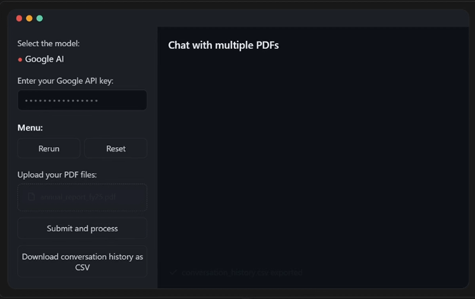

# 📚 Financial Analyst RAG

A Streamlit app that lets you load several PDFs at once and query them in natural language, powered by **Google's Gemini 3.8**. It's tuned for digging through **annual reports** and **financial statements**, with a particular eye toward Indian listed companies.


---

## 🎬 Demo



---

## 🚀 What it does

- 📄 Load multiple PDFs in a single session
- 🤖 Chat with their combined content
- 🧠 Answers are generated through LangChain + Gemini (`gemini-3.8-flash`)
- 🗃️ Documents are embedded with `GoogleGenerativeAIEmbeddings` and indexed in a FAISS vector store
- 📊 Prompting is tailored for financial statements, related-party disclosures, and executive pay
- 🗨️ Conversational UI with distinct avatars for you and the model
- 📥 One-click export of the full conversation to CSV

---

## 🛠️ Getting started

### 1. Grab the project

```bash
cd pdf-chatbot-gemini
```

### 2. Spin up a virtual environment

```bash
python -m venv venv
source venv/bin/activate
```

### 3. Install dependencies

```bash
# pip
pip install -r requirements.txt

# or uv (faster, recommended)
uv sync
```

### 4. Launch it

```bash
streamlit run app.py
```

---

## 🔐 Google AI API key

The app needs a Gemini API key to run:

1. Head to [Google AI Studio](https://ai.google.dev/)
2. Create a key
3. Paste it into the **sidebar** once the app is running

---

## 📦 Built with

| Component  | Role                                     |
| ---------- | ----------------------------------------- |
| Streamlit  | The web UI                                |
| LangChain  | Orchestrates the retrieval + LLM chain    |
| Gemini 3.8 | Generates the answers (via Google AI API) |
| PyPDF2     | Pulls text out of the PDFs                |
| FAISS      | Similarity search over the embeddings     |
| Pandas     | Builds the CSV export                     |
| HTML/CSS   | Styles the chat bubbles in Streamlit      |

---

## 📁 Layout

```
├── app.py               # The Streamlit app
├── faiss_index/         # Saved vector store
├── requirements.txt     # Python dependencies
└── README.md            # This file
```

---

## 🧠 How the prompt is shaped

The system prompt steers the model toward finance-specific reasoning, pushing it to:

- Read financial statements critically, not just summarize them
- Surface anything that looks like a red flag
- Trace related-party transactions across the filings
- Catch outlier movements in managerial remuneration

---

## 🧪 What you can try

- Compare **debt-to-equity ratios** across a batch of annual reports
- Hunt for questionable **related-party transactions**
- Check how well **CFO converts to net profit** over time
- See how **Key Managerial Personnel (KMP)** compensation has trended

